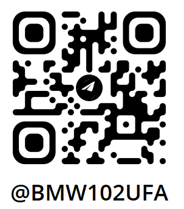
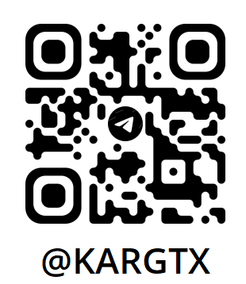

# 🟦🟦 BMW102 · Контакты 🟥

**Плитка «BMW102» в меню головного устройства (МГУ) с контактами.** ID7 и ID8.
Без сети, без движка и без диагностики — одна страница с текстом.

| Кому | Телефон | Telegram |
|---|---|---|
| **BMW102** — ремонт и обслуживание | +7 965 925 6666 | [@BMW102UFA](https://t.me/BMW102UFA) |
| **KARGTX** — техподдержка приложений | — | [@KARGTX](https://t.me/KARGTX) |

<p>
  
  
</p>

## Экран

```
┌ BMW102 ─────────────────────────────────────────────┐
│ Контакты BMW102. Выберите, кому позвонить или написать.│
│ ▸ Ремонт и обслуживание · +7 965 925 6666            │
│ ▸ Техподдержка приложений · Telegram @KARGTX         │
│ Telegram: @BMW102UFA — сервис, @KARGTX — приложения.  │
└─────────────────────────────────────────────────────┘
```

Нажатие на контакт показывает внизу его телефон и Telegram.

## Установка

Как у G-xDrive, только без движка (`mgu-python` не нужен).

**USB-флешка.** Готовая папка рядом с проектом — `USB-флешка-BMW102`. Скопируйте её
содержимое в корень флешки (FAT32/exFAT), чтобы получилось
`E:\mgu-repo\bmw102-contacts\mgu-repo.json`. Store → **USB** → источник
`…/mgu-repo/bmw102-contacts` → **BMW102 · Контакты** → **Install**.

Обновить флешку после правок (Node 18+):
```powershell
node ..\mgu-store\deploy\mgu-install.js usb-repo E:\ .
```

**GitHub.** Репозиторий с этой папкой в корне (`mgu-repo.json` наверху) —
Store → Настройки → Источники → Добавить источник → `владелец/репозиторий`, ветка `main`.

## Структура

```
mgu-repo.json            каталог для Store (один компонент: app)
app/mgu-app.json         сборка плитки на МГУ
app/src/app.js           страница и жизненный цикл (каркас из G-xDrive)
app/package/             манифест, rhmiData (ID7/ID8, тексты ru/en/de, иконка)
docs/                    QR-коды Telegram
```

Поменять контакты: `app/src/app.js` (константы `CONTACTS`, `STR`) и тексты
`app/package/rhmiData/variantGroups/Common/texts/*.json`, затем поднять версию в
`app/mgu-app.json`, `app/package/package.json`, `rhmiData/application.json`.
