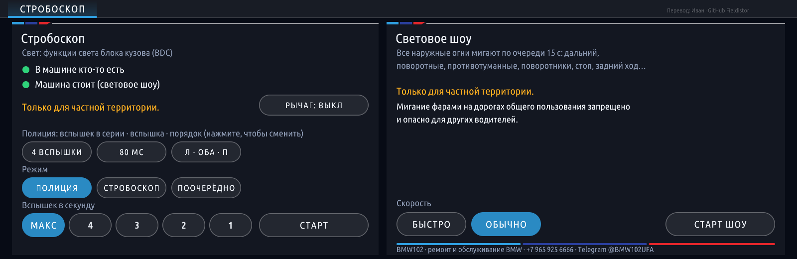
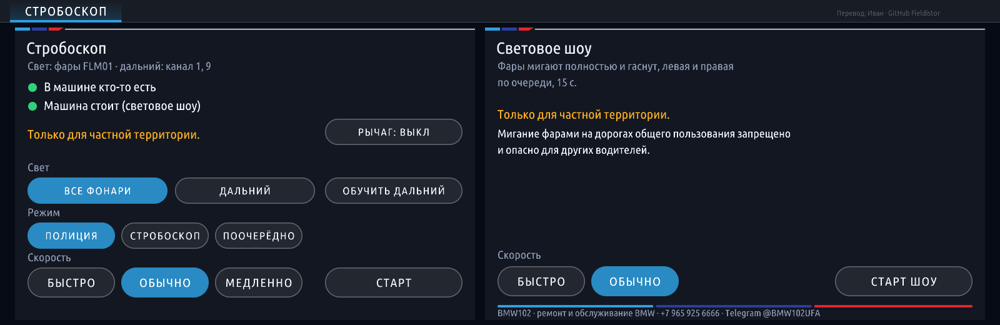

# 🟦🟦 BMW102 · Flash 🟥

**Стробоскоп дальним светом и световое шоу — экран и логика как у страницы *Strobe* в *Ambient config***
из [cauliflowermossgrape/idrive7-apps](https://github.com/cauliflowermossgrape/idrive7-apps) (2.7.3, MIT):
те же две панели, кнопки, проверки и запуск рычагом. Тексты на русском, тема **BMW102** (тёмно-синий фон,
полосы голубой · синий · красный, подпись сервиса внизу). ID7 и ID8, без адаптера — команды шлёт сама МГУ (TASU).

> ⚠️ **Только для частной территории.** Мигание фарами на дорогах общего пользования запрещено и опасно.




## Что на экране

**Стробоскоп** (слева): какой свет найден; проверки — *в машине кто-то есть*, *машина стоит (световое шоу)*;
**Рычаг: Вкл/Выкл**; ниже — то, что умеют найденные фары:

| Фары | Кнопки |
|---|---|
| Функции света BDC, режим Полиция | вспышек в серии 1–4 · длина вспышки 50/80/100/150 мс · порядок Л·Оба·П / Л·П·Оба / Л·П |
| Функции света BDC, другие режимы | свет Все фонари / Дальний · длина вспышки |
| LED-фары FLM01 / FLE | свет Все фонари / Дальний · **Обучить дальний** |
| Функции света BDC | вспышек в секунду Макс / 4 / 3 / 2 / 1 |
| Остальные | скорость Быстро / Обычно / Медленно |

Режим Полиция / Стробоскоп / Поочерёдно и **Старт** (первое нажатие взводит — «Подтвердить», второе запускает).

**Световое шоу** (справа): скорость Быстро / Обычно и **Старт шоу**, 15 с. Если свет не найден — «Найти фары».
**Настройки** (кнопка внизу): «Запуск рычагом и на ходу».

## Как в прототипе

- Стробоскоп работает и на ходу; световое шоу — только когда машина стоит (≤ 3 км/ч); всё — только пока
  в машине кто-то есть (VehicleCondition; закрыли и ушли — остановка).
- **Рычаг:** с «Рычаг: Вкл» **5 нажатий рычага дальнего (моргнуть дальним) за 10 с** запускают стробоскоп
  с настройками страницы, **следующее нажатие — останавливает**. Нажатие — дальний включён не дольше 1,5 с;
  если держать дольше (включили дальний), счёт сбрасывается. На ходу — только с настройкой «Запуск рычагом
  и на ходу». (В прототипе запускал один рывок — у BMW102 пять, чтобы не включить случайно.)
  Приложение стартует вместе с МГУ, поэтому рычаг работает с закрытой плиткой.
- **Без ограничения по времени:** запущенный стробоскоп мигает, пока его не остановят — кнопкой «Стоп» или одним
  нажатием рычага дальнего (или если машину закрыли и ушли). Паузы для отдыха фар и лимита мигания за 10 мин нет
  (в прототипе — ≤30 с за раз, отдых, ≤2 мин за 10 мин). Световое шоу по-прежнему 15 с.
- Движок `strobe.js`: ток LED не выше
  кодировки, стоп при перегреве FLM01 ≥ 90 °C, фары возвращаются машине.

## Устройство

Приложение собрано на **MGU App Kit** из idrive7-apps (папка `kit/`, MIT, см. `LICENSE-idrive7-apps`):
экран рисуется канвасом и показывается **GPU renderer**'ом (`idrive7-renderd`), кнопки на странице и крутилка
iDrive работают через **Controller gate** (`mgu-inputgate`) — как у самого Ambient config. Поэтому эти два
инструмента должны стоять: Store → источник *idrive7-apps* → GPU renderer и Controller gate (если Ambient config
у вас работает — они уже есть).

Store собирает приложение на МГУ сам: `python3 flash/kit/tools/build.py --language ru bmw102_flash`
(mgu-python), результат — `flash/dist/bmw102_flash@<версия>.tgz`.

Изменения kit от оригинала: тема `bmw102` в `kit/runtime/themes.js`; `kit/tools/localize.py` не дописывает язык
к версии пакета. Из `kit/localization` оставлены только русский шрифт и подпись перевода.

Файлы приложения — `apps/bmw102_flash/`: `main.js` (экран и логика), `strobe.js`, `lever.js`, `app.json`
(сигналы, настройки), `icon.png`. Каналы дальнего — `strobe_channels.json`, настройки — в папке данных приложения.

Журнал: `journalctl | grep bmw102_flash`.

## Проверка на ПК

```bash
python3 flash/kit/tools/build.py --language ru --preview-only bmw102_flash
```
